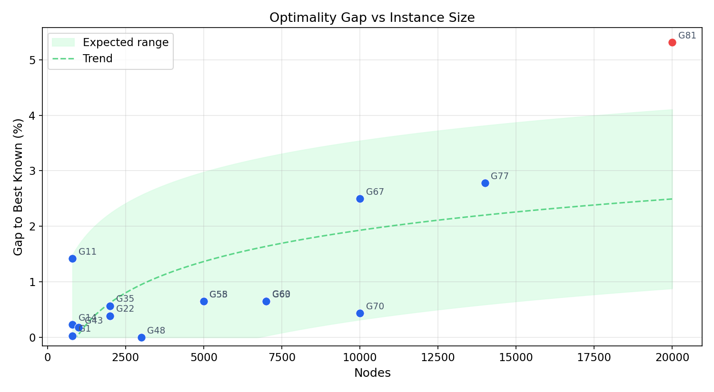
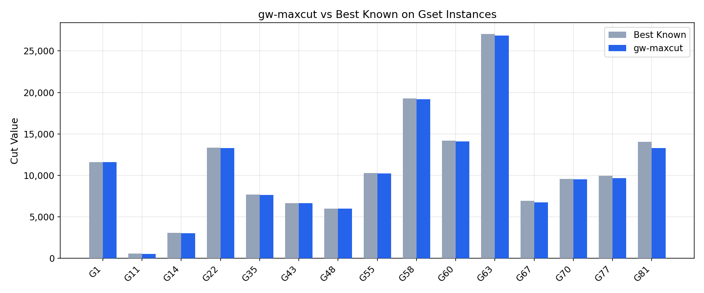
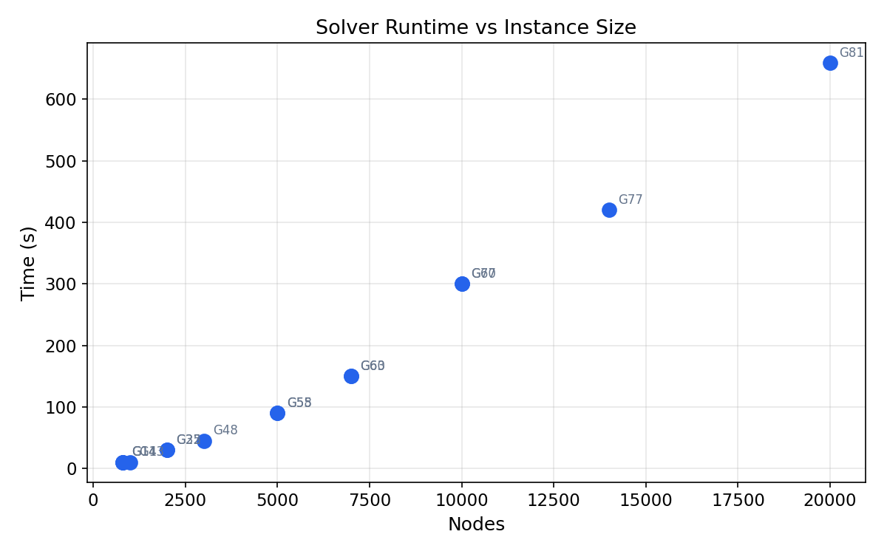
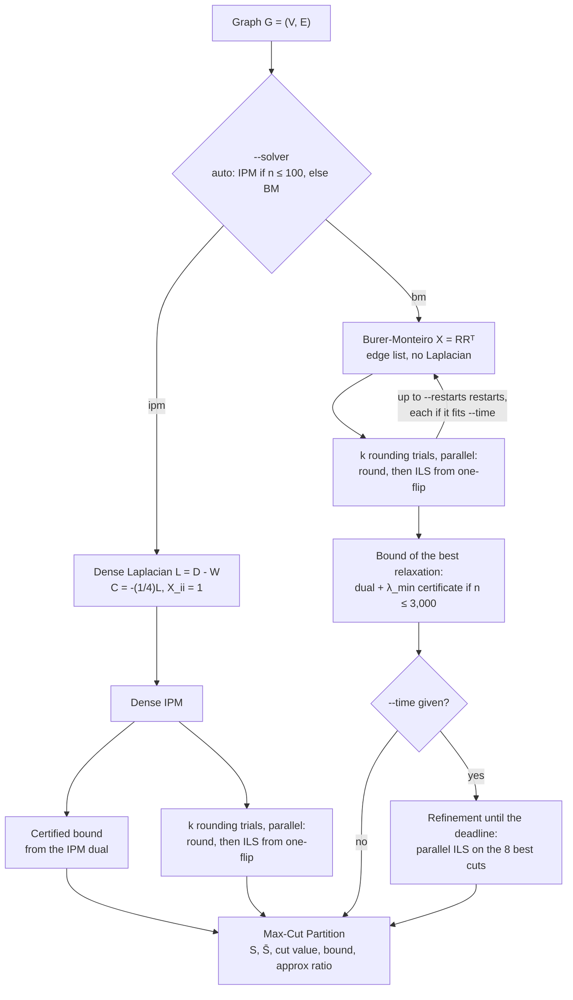

# maxcut-sdp

A from-scratch semidefinite programming (SDP) solver with Goemans-Williamson Max-Cut approximation, written in Rust.

I learned the theory behind this project in **CMPUT 498: Advanced Algorithms** and built this as a portfolio project to solidify my understanding of semidefinite programming, interior point methods, and approximation algorithms.

## What This Is

This project implements the entire pipeline from scratch — no CVXPY, no MOSEK, no BLAS, no external optimization or linear algebra libraries. Every component is hand-written:

- **Dense linear algebra**: Cholesky factorization, Jacobi eigendecomposition, the smallest eigenvalue by Householder tridiagonalization and bisection, matrix square roots, blocked matrix multiply
- **Primal-dual interior point method**: Nesterov-Todd scaling, Schur complement system, central-path step control
- **Burer-Monteiro low-rank solver**: Riemannian nonlinear CG on the factored form $X = RR^T$, working from the edge list without forming the Laplacian, scalable to 20,000 nodes
- **GW rounding pipeline**: random hyperplane rounding or Zwick's outward rotations, then iterated local search with variable perturbation starting from one-flip local search; with BM and `--time`, parallel iterated local search on the 8 best cuts until the budget ends

The only dependencies are `clap` for the CLI, `rand`, and `rayon`, which runs the rounding trials, the BM objective and gradient, and the eigenvalue certificate in parallel.

## The Math

The GW algorithm relaxes the NP-hard Max-Cut integer program into a semidefinite program, solves it in polynomial time, then rounds the continuous solution back to a discrete partition. The celebrated result is that, on graphs with non-negative weights, this achieves at least $87.8\%$ of the optimal cut value in expectation — and under the Unique Games Conjecture, no polynomial-time algorithm can do better.

Full mathematical derivations are in the `MATH.md` files:
- [`src/sdp/MATH.md`](src/sdp/MATH.md) — SDP standard form, duality theory, the primal-dual interior point method with Nesterov-Todd scaling, and Burer-Monteiro: the product-of-spheres manifold, the Riemannian gradient, CG with Armijo backtracking, and the certified bound (section 7.10)
- [`src/maxcut/MATH.md`](src/maxcut/MATH.md) — GW algorithm, the rounding proof, outward rotations, one-flip local search, the approximation guarantee, and a checklist mapping each step to its function

## Gset Benchmarks

Tested on the [Gset benchmark suite](https://web.stanford.edu/~yyye/yyye/Gset/) (800–20,000 nodes). All cut values are independently verified. Best-known values are from BLS, MCPG, CirCut, and recent literature.

| Instance | Nodes | Edges | Best Known | maxcut-sdp | Gap | Time |
|----------|------:|------:|-----------:|----------:|----:|-----:|
| G1       |   800 | 19,176 |     11,624 |    11,621 | 0.03% |   10s |
| G11      |   800 |  1,600 |        564 |       556 | 1.42% |   10s |
| G14      |   800 |  4,694 |      3,064 |     3,057 | 0.23% |   10s |
| G22      | 2,000 | 19,990 |     13,359 |    13,307 | 0.39% |   30s |
| G35      | 2,000 | 11,778 |      7,687 |     7,643 | 0.57% |   30s |
| G43      | 1,000 |  9,990 |      6,660 |     6,648 | 0.18% |   10s |
| G48      | 3,000 |  6,000 |      6,000 |     6,000 | 0.00% |   45s |
| G55      | 5,000 | 12,498 |     10,299 |    10,232 | 0.65% |   90s |
| G58      | 5,000 | 29,570 |     19,293 |    19,168 | 0.65% |   90s |
| G60      | 7,000 | 17,148 |     14,188 |    14,095 | 0.66% |  150s |
| G63      | 7,000 | 41,459 |     27,047 |    26,872 | 0.65% |  150s |
| G67      |10,000 | 20,000 |      6,950 |     6,776 | 2.50% |  300s |
| G70      |10,000 |  9,999 |      9,591 |     9,549 | 0.44% |  300s |
| G77      |14,000 | 28,000 |      9,940 |     9,664 | 2.78% |  420s |
| G81      |20,000 | 40,000 |     14,060 |    13,314 | 5.31% |  660s |

**Median gap: 0.65%** across all 15 instances. 11 of 15 instances within 1% of best-known.

These numbers and the charts below were measured before the November 2026 code changes and are pending a re-run; 8 of the 15 Gset files cannot be downloaded at the moment.







## Architecture



## Build & Run

```bash
# Build (.cargo/config.toml sets target-cpu=native, so the binary is tuned to this CPU and may not run on others)
cargo build --release

# Run on a graph file (auto-detects format)
./target/release/maxcut-sdp graph.txt --solver bm

# Time-budgeted solve (recommended for large instances)
./target/release/maxcut-sdp graph.txt --solver bm --time 300

# Run with exact comparison (small graphs only)
./target/release/maxcut-sdp graph.txt --solver ipm --exact

# Reproduce benchmarks: fetch the Gset graphs (benchmark.sh skips missing ones),
# run BM with --seed 42 and a size-based --time budget, then draw the charts (needs matplotlib)
./scripts/download.py gset
mkdir -p results && ./scripts/benchmark.sh > results/gset.csv
python3 scripts/plot.py results/gset.csv charts

# Generate a random sparse graph: 5,000 vertices, about five neighbours each
./scripts/gen_random_graph.py 5000 > random_5000.txt
```

### CLI Options

| Flag | Default | Description |
|------|---------|-------------|
| `--solver` | `auto` | Solver backend: `ipm` (dense, exact), `bm` (scalable), or `auto`: the IPM up to 100 vertices, BM past them |
| `--time` | — | Time budget in seconds for `--solver bm`: up to `--restarts` restarts that fit (the first always runs to completion), then parallel iterated local search on the 8 best cuts until the budget ends |
| `--trials` | 100 | Rounding trials, hyperplane or outward rotation; with BM, per restart, so a default BM run makes 300 |
| `--ils-rounds` | 50 | Iterated local search rounds per trial |
| `--rotation` | off | Round with Zwick's outward rotation by this angle in radians, within $[0, \pi/2]$ |
| `--restarts` | 3 | BM random restarts |
| `--rank` | auto | BM factorization rank, within $[2, n]$ (default: $\lceil\sqrt{2n}\rceil$) |
| `--seed` | random | RNG seed; a seeded run is reproducible, parallel parts included, unless `--time` is given: how many restarts fit and how long refinement runs then depend on the clock |
| `--epsilon` | 1e-8 | IPM tolerance on the relative duality gap and infeasibilities (`--solver ipm` only) |
| `--exact` | off | Also compute the brute-force optimum, up to 24 vertices; past that it prints `Exact solver skipped` |
| `--format` | detected | Read the file as `biqmac` or `dimacs` instead of detecting the format from its content |

`--epsilon` applies only to the IPM, and `--rank`, `--restarts` and `--time` only to BM; giving one to the solver that does not read it, including the one `--solver auto` picks, is an error. `--help` describes every flag.

Results go to stdout and progress to stderr. The exit status is 0 on success; 2 for a flag the chosen solver does not read, or any other command-line error; and 1 when the file cannot be read or parsed or the solver fails, including when the reported cut does not match its partition (`VERIFICATION FAILED`).

The reported SDP bound is certified: a dual solution proves no cut exceeds it, even when the solver stopped short of the SDP's optimum. BM certifies graphs of up to 3,000 vertices; past that the dense eigenvalue the certificate needs is too slow, so it prints its relaxation value, which is not a bound, and no approximation ratio. With `--time`, certification counts against the budget.

Outward rotations did not raise the final cut on the Biq Mac instances or on random graphs of up to 5,000 nodes: with the default 50 ILS rounds no angle from 0.1 to 0.5 improved any of them, and larger angles lost up to 0.5% on the biggest graphs. Iterated local search already closes the gap they target, so hyperplane rounding stays the default.

### Supported Input Formats

- **Biq Mac Library** (`.mc`, and the Gset files): First line `n m`, then lines of `i j [w]`; weights default to 1, and `m` is not checked against the edge lines
- **DIMACS**: One problem line `p edge n m` (or `p col n m`), then `e i j [w]` lines; weights default to 1

The format is detected from the content, not the file name: a line starting with `p ` or `e ` means DIMACS. Vertices are numbered from 1. Self-loops and out-of-range vertices are errors; negative weights are accepted.

## Project Structure

```
src/
├── main.rs              CLI entry point
├── lib.rs               Crate root, error types, re-exports
├── graph.rs             Graph representation and Laplacian construction
├── parser.rs            Biq Mac and DIMACS format parsers
├── random.rs            Box-Muller normal samples
├── sdp/
│   ├── mod.rs           SDP problem formulation
│   ├── ipm.rs           Primal-dual interior point method
│   ├── bm.rs            Burer-Monteiro low-rank solver
│   ├── linalg.rs        Dense linear algebra (Cholesky, eigendecomp, etc.)
│   └── MATH.md          Mathematical reference
└── maxcut/
    ├── mod.rs           GW pipeline, solver backends, certified bounds
    ├── bm_pipeline.rs   BM restarts and time-budgeted refinement
    ├── rounding.rs      Hyperplane rounding, one-flip local search, ILS
    ├── exact.rs         Brute-force exact solver (small graphs)
    └── MATH.md          Mathematical reference
tests/                   Integration tests, with shared graph builders in common/
benches/maxcut_bench.rs  Criterion benchmarks of the solvers and the pipeline
scripts/
├── benchmark.sh         Gset benchmark run, CSV to stdout
├── download.py          Fetch Biq Mac (small, rudy, ising) and Gset instances
├── plot.py              Charts from the benchmark CSV
├── gen_random_graph.py  Random sparse graph generator
└── best_known.txt       Best-known Gset cut values
charts/                  Charts shown above
```

## Testing

```bash
cargo test --release   # release mode: the seeded 3,000-vertex tests take minutes unoptimized
cargo bench            # criterion benchmarks
```

CI runs `cargo fmt --check`, `cargo clippy --all-targets -- -D warnings`, `cargo test --release` and `cargo doc --no-deps` on pushes to main and on pull requests.

## References

- M. X. Goemans and D. P. Williamson, "Improved Approximation Algorithms for Maximum Cut and Satisfiability Problems Using Semidefinite Programming," *Journal of the ACM*, 42(6):1115–1145, 1995.
- S. Burer and R. D. C. Monteiro, "A nonlinear programming algorithm for solving semidefinite programs via low-rank factorization," *Mathematical Programming*, 95(2):329–357, 2003.
- U. Zwick, "Outward rotations: a tool for rounding solutions of semidefinite programming relaxations," *STOC*, 1999.
- L. Vandenberghe and S. Boyd, "Semidefinite Programming," *SIAM Review*, 38(1):49–95, 1996.
- S. Khot, G. Kindler, E. Mossel, and R. O'Donnell, "Optimal Inapproximability Results for MAX-CUT and Other 2-Variable CSPs?" *SIAM Journal on Computing*, 37(1):319–357, 2007.
- [Biq Mac Library](https://biqmac.aau.at/) — benchmark instances for Max-Cut and quadratic binary optimization.
- [Gset Benchmarks](https://web.stanford.edu/~yyye/yyye/Gset/) — standard large-scale Max-Cut test instances.
